<div align="center">

# 📈 ValorGanado · Control EVM

**El control de un proyecto de software con el método del valor ganado, convertido en un portal interactivo y verificable**

      

**[🌐 Portal en vivo](https://evm.iagentek.com.mx)** · **[🎬 Video del recorrido](docs/readme/recorrido.mp4)** · **[🔀 Enfoque híbrido](https://evm.iagentek.com.mx/hibrido)** · **[📦 Entregables](https://evm.iagentek.com.mx/entregables)** · **[🛡️ Cumplimiento](https://evm.iagentek.com.mx/cumplimiento)**

*UNIR México · Maestría en Inteligencia Artificial · Metodología de Diseño y Gestión de Proyectos · Actividad 2 individual*
*Adonai Samael Hernández Mata · Profesora: Adriana Cervantes Castillo · Noviembre de 2026*


</div>

## ✨ En una mirada

| Proyecto | Mes 3 · Parte A | Mes 5 · Parte B | Medidas (meses 4–5) | Clásico + ágil | Rúbrica |
|---|---|---|---|---|---|
| 💰 **$115 000** · 📅 **6** meses | 🔴 CPI **0,734** · SPI **0,788** | 🟡 CPI **0,929** · SPI **0,989** | 🟢 CPI **1,206** · SPI **1,268** | 🔀 **12** iteraciones de 2 semanas | ✅ **16/16** · 38/38 comprobaciones |

| | Mes 3 (Parte A) | Mes 5 (Parte B) |
|---|---|---|
| **EV** = BAC × % avance acumulado | $42 550 (37 %) | $92 000 (80 %) |
| **CPI** = EV ÷ AC | **0,734** · por encima del presupuesto | **0,929** · por encima, mucho menos |
| **SPI** = EV ÷ PV | **0,788** · retrasado | **0,989** · casi en plazo |
| **EAC** = AC + (BAC − EV) | **$130 450** | **$122 000** |
| **Duración** ≈ 6 ÷ SPI | **7,61 meses** | **6,07 meses** |

Las medidas del mes 3 **funcionaron**: solo en los meses 4 y 5, CPI = 1,206 y SPI = 1,268 (ambos por encima de 1).

## 🧭 Contenido

- [Qué es](#-qué-es)
- [Clásico + ágil: la retroalimentación de la Actividad 1](#-clásico--ágil-la-retroalimentación-de-la-actividad-1)
- [Cómo cubre la rúbrica](#-cómo-cubre-la-rúbrica)
- [Recorrido por el portal](#️-recorrido-por-el-portal)
- [Lo interactivo](#-lo-interactivo)
- [En el celular](#-en-el-celular)
- [Figuras y diagramas](#-figuras-y-diagramas)
- [Arquitectura](#️-arquitectura)
- [Metodología](#-metodología)
- [Validación](#-validación)
- [Entregables](#-entregables)
- [Estructura del repositorio](#-estructura-del-repositorio)
- [Reproducir](#️-reproducir)

## 📌 Qué es

La actividad pide controlar un proyecto de software de **seis meses** y **$115 000** con el método de gestión del valor
ganado (Tema 5, apartado 5.9) en dos cortes: el **mes 3** y el **mes 5**, con cinco preguntas en cada uno. El documento
entregado (4 páginas, Calibri 12, interlineado 1,5) responde las diez; este portal lo presenta paso a paso, lo comprueba
y lo amplía con un laboratorio, una simulación del cierre y el enfoque híbrido.

| Mes | 1 | 2 | 3 | 4 | 5 | 6 | Total |
|---|---|---|---|---|---|---|---|
| **PV** (línea base) | $23 000 | $15 000 | $16 000 | $19 000 | $20 000 | $22 000 | $115 000 |
| **AC** (coste real) | $21 000 | $18 000 | $19 000 | $20 000 | $21 000 | — | $99 000 |
| **Avance del mes** | 8 % | 15 % | 14 % | 21 % | 22 % | — | 80 % |

> [!WARNING]
> **La trampa del enunciado.** El avance viene mes a mes, pero el EV usa el **acumulado** (37 % al mes 3 y 80 % al mes 5).
> Con el avance de un solo mes (14 % o 22 %) el EV saldría de $16 100 o $25 300 y todas las respuestas cambiarían.
> El portal lo explica en [/planteamiento](https://evm.iagentek.com.mx/planteamiento) y el cumplimiento lo verifica (D.1).

> [!NOTE]
> **Una sola fuente de verdad.** Las cifras salen de `fuente/calculos.py` (aritmética exacta con fracciones) y los textos de
> `fuente/contenido.py`, los mismos archivos que generan el .docx y el .pdf. La API vuelve a calcular todo con su propio
> motor (`backend/app/evm.py`) y las pruebas comprueban que ambos dan exactamente lo mismo: **el portal no puede decir algo
> distinto del documento**.

## 🔀 Clásico + ágil: la retroalimentación de la Actividad 1

En la Actividad 1 la profesora comentó: *«En la realidad podemos complementar las metodologías ágiles con las clásicas
para mejorar los resultados finales»*. Esta entrega lo incorpora de forma explícita:

| Del enfoque clásico (PMBOK® · Tema 5) | Del enfoque ágil (Scrum · Tema 2) |
|---|---|
| Línea base de coste y alcance (BAC de $115 000) | Iteraciones de dos semanas: doce en seis meses |
| Valor ganado mensual con umbrales (CPI y SPI < 0,90 se escalan) | Backlog priorizado con el cliente, paquetes pequeños |
| Control formal de cambios (5.7) | Revisión y criterios de aceptación: solo lo aceptado cuenta como avance |
| Hitos e informes de estado en los meses 3 y 5 | Retrospectiva y reunión diaria |

- **En el documento:** la estrategia 3 de la Parte A5 (*«Recursos y paquetes pequeños en un enfoque híbrido»*) y la conclusión.
- **En el portal:** la página [Enfoque híbrido](https://evm.iagentek.com.mx/hibrido) con el burn-up de las doce iteraciones
  y el **pronóstico del plazo por velocidad**, que confirma el cálculo clásico con un método independiente:

| ¿Cuándo termina? | Cálculo | Mes 3 | Mes 5 |
|---|---|---|---|
| **Clásico (el del documento)** | 6 ÷ SPI | **7,61 meses** | **6,07 meses** |
| Ágil · velocidad media | mes + falta ÷ velocidad desde el inicio | 8,11 meses | 6,25 meses |
| Ágil · velocidad reciente | mes + falta ÷ velocidad de los dos últimos meses | 7,34 meses | 5,93 meses |

<p align="center">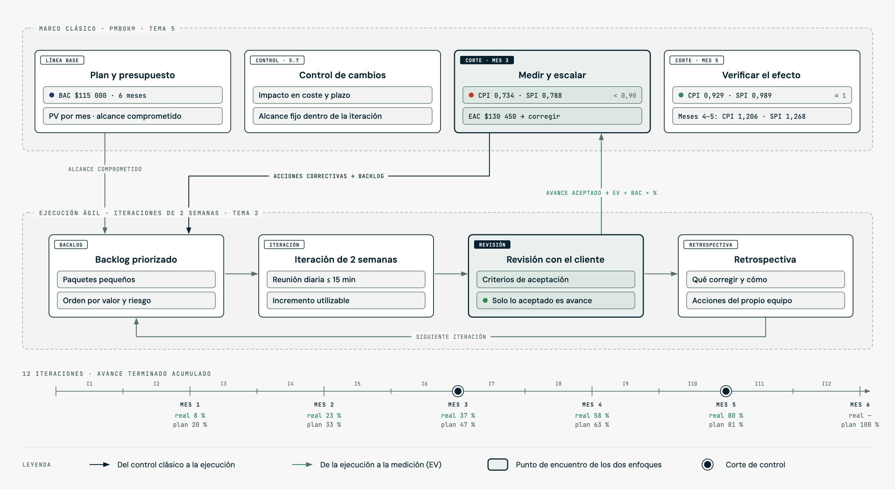</p>

## ✅ Cómo cubre la rúbrica

Cada requisito se **comprueba en el servidor**: las cifras de las diez respuestas se recalculan y se buscan en el texto y en
el .docx entregado; las páginas y la fuente se leen del propio documento. Nada se marca a mano:
[ver cumplimiento en vivo](https://evm.iagentek.com.mx/cumplimiento).

| Criterio | Qué pide | Evidencia |
|---|---|---|
| **1. Parte A (40 %)** | Cinco preguntas del mes 3, correctas y justificadas | CPI, SPI, EAC, duración y tres estrategias de control del curso, la tercera con enfoque híbrido · [/parte-a](https://evm.iagentek.com.mx/parte-a) · [/hibrido](https://evm.iagentek.com.mx/hibrido) |
| **2. Parte B (40 %)** | Cinco preguntas del mes 5, correctas y justificadas | Los mismos indicadores y el efecto de las medidas con el desempeño de los meses 4–5 · [/parte-b](https://evm.iagentek.com.mx/parte-b) |
| **3. Presentación (20 %)** | Redacción clara y extensión máxima | 4 de 4 páginas, Calibri 12, interlineado 1,5, fuentes citadas · [/entregables](https://evm.iagentek.com.mx/entregables) |

<details>
<summary><b>Los 16 requisitos que se comprueban</b></summary>

| Id | Criterio | Requisito | Estado |
|---|---|---|---|
| A.1 | C1 | Mes 3 · CPI: ¿por encima o por debajo del presupuesto? | ✅ |
| A.2 | C1 | Mes 3 · SPI: ¿retrasado o adelantado? | ✅ |
| A.3 | C1 | Mes 3 · EAC según el presupuesto original | ✅ |
| A.4 | C1 | Mes 3 · ¿terminará con retraso o adelanto? | ✅ |
| A.5 | C1 | Al menos dos estrategias de control vistas en el curso | ✅ |
| A.6 | C1 | Complementa el control clásico con prácticas ágiles (enfoque híbrido) | ✅ |
| B.1 | C2 | Mes 5 · CPI: ¿por encima o por debajo del presupuesto? | ✅ |
| B.2 | C2 | Mes 5 · SPI: ¿retrasado o adelantado? | ✅ |
| B.3 | C2 | Mes 5 · EAC según el presupuesto original | ✅ |
| B.4 | C2 | Mes 5 · ¿terminará con retraso o adelanto? | ✅ |
| B.5 | C2 | ¿Las medidas del mes 3 tuvieron efecto positivo o negativo? (justificado) | ✅ |
| D.1 | Datos | El EV usa el avance acumulado (no el del mes) | ✅ |
| C3.1 | C3 | Extensión máxima de 4 páginas | ✅ |
| C3.2 | C3 | Calibri 12 e interlineado 1,5 | ✅ |
| C3.3 | C3 | El documento entregado dice lo mismo que el portal | ✅ |
| C3.4 | C3 | Cita las fuentes del método | ✅ |

</details>

## 🗺️ Recorrido por el portal

<table>
<tr>
<td width="50%">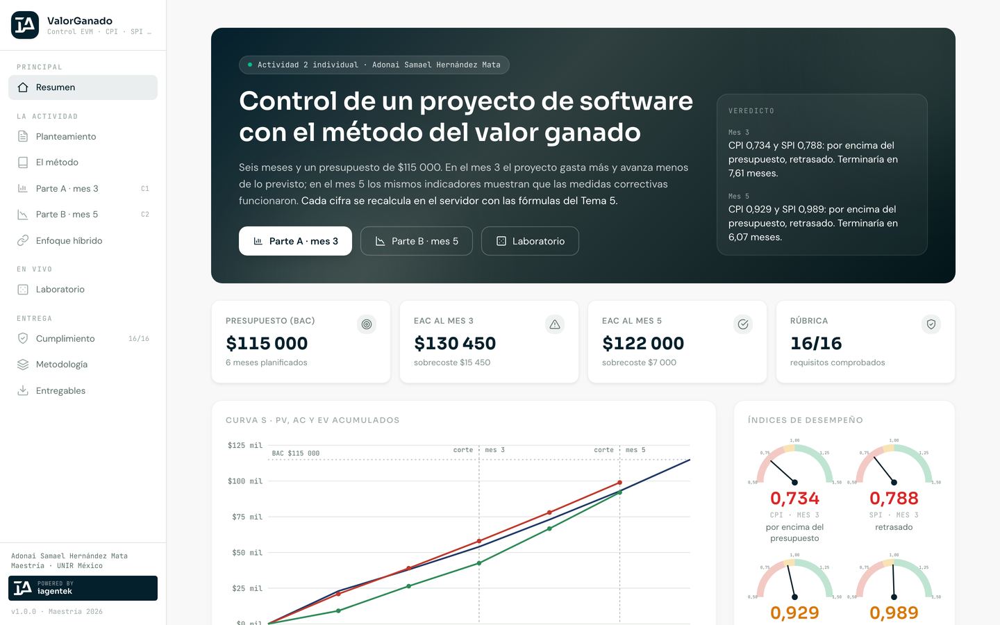<br><sub><b>Resumen</b> · veredicto de los dos cortes, cifras clave, curva S y medidores de CPI y SPI</sub></td>
<td width="50%">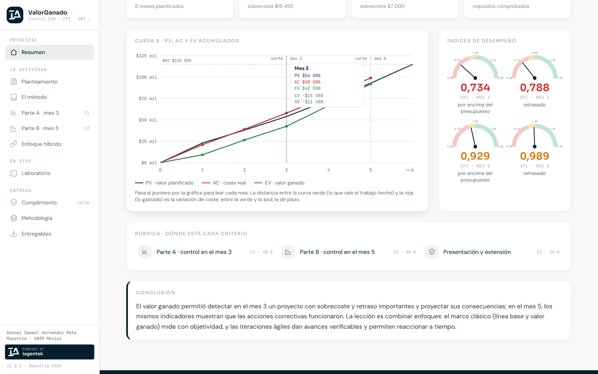<br><sub><b>Curva S</b> · PV, AC y EV acumulados; al pasar el puntero, la lectura del mes con CV y SV</sub></td>
</tr>
<tr>
<td>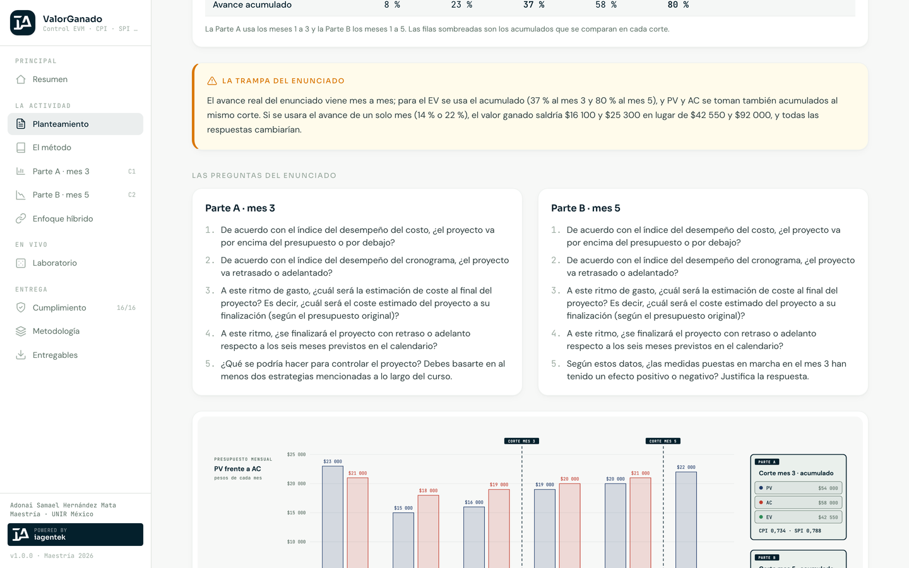<br><sub><b>Planteamiento</b> · línea base, mediciones reales y la trampa del avance acumulado</sub></td>
<td>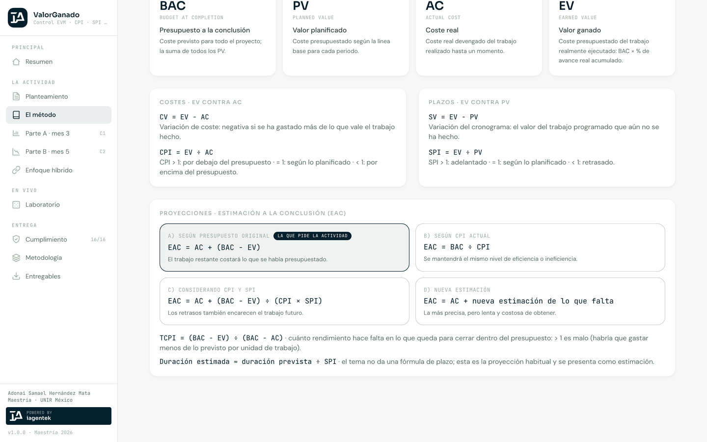<br><sub><b>El método</b> · variables y fórmulas de las Tablas 9 a 12 del Tema 5, con las cuatro variantes del EAC</sub></td>
</tr>
<tr>
<td>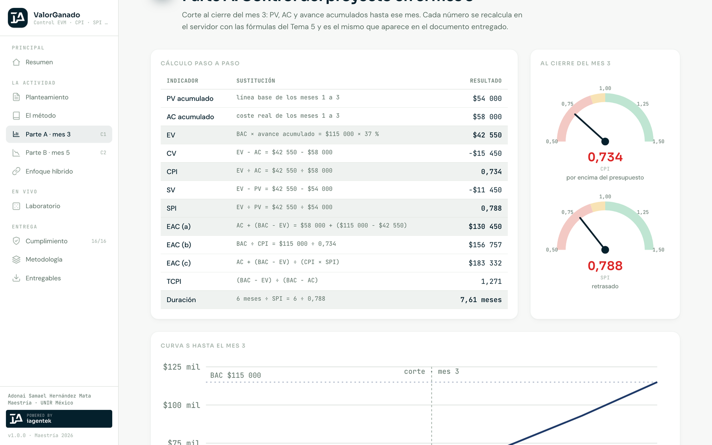<br><sub><b>Parte A · mes 3</b> · cálculo paso a paso con cada sustitución y medidores del corte</sub></td>
<td>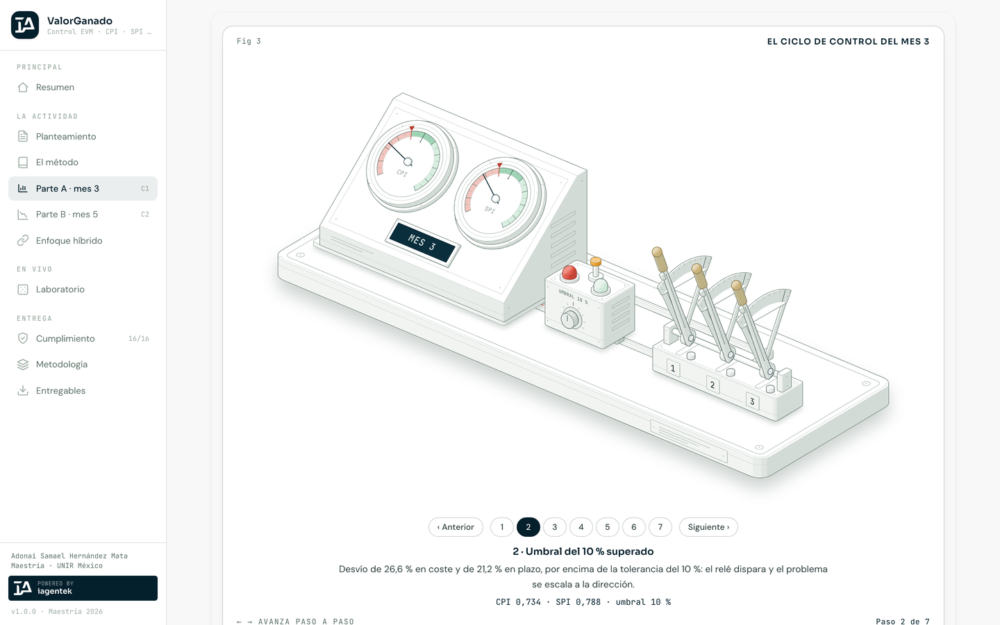<br><sub><b>Ciclo de control</b> · figura isométrica: medición, umbral del 10 %, tres palancas y regreso a la tolerancia</sub></td>
</tr>
<tr>
<td>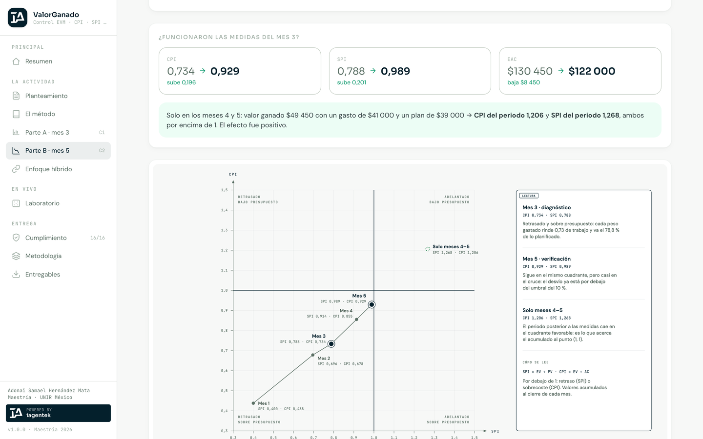<br><sub><b>Parte B · mes 5</b> · las cinco respuestas y si funcionaron las medidas del mes 3</sub></td>
<td>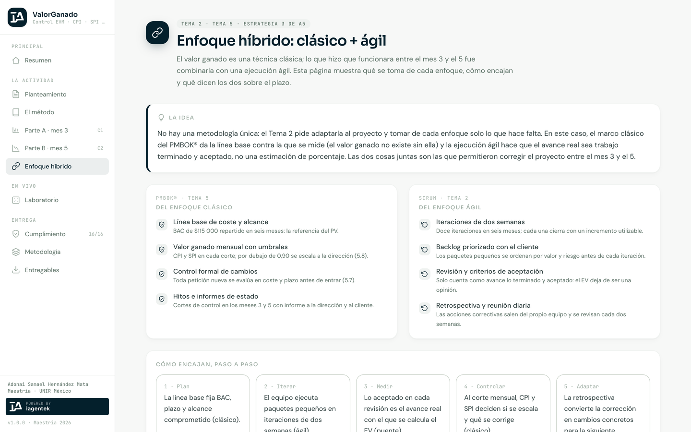<br><sub><b>Enfoque híbrido</b> · qué se toma del enfoque clásico y del ágil, y cómo encajan paso a paso</sub></td>
</tr>
<tr>
<td>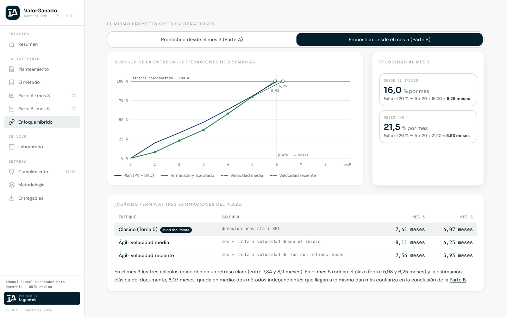<br><sub><b>Burn-up</b> · doce iteraciones, plazo de seis meses y pronóstico por velocidad desde el mes 3 o el 5</sub></td>
<td>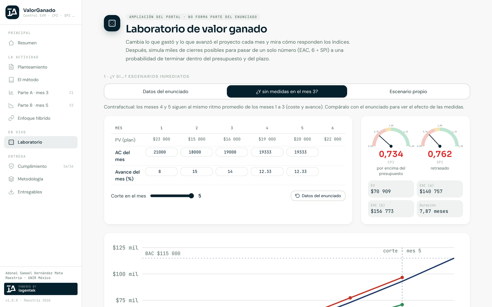<br><sub><b>Laboratorio</b> · «¿y sin medidas en el mes 3?»: el servidor recalcula los indicadores al instante</sub></td>
</tr>
<tr>
<td>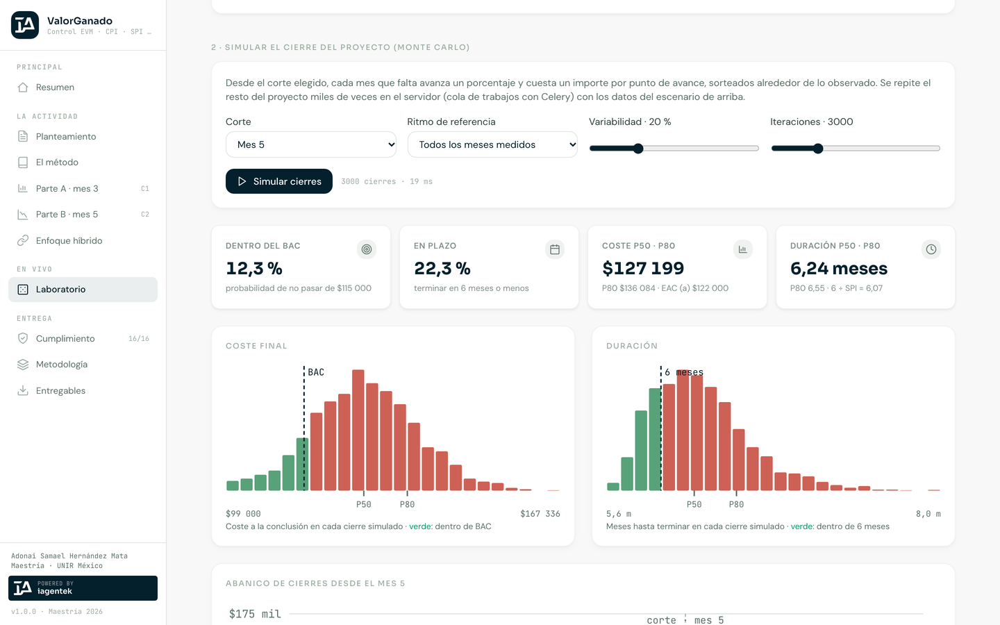<br><sub><b>Simulación Monte Carlo</b> · miles de cierres: probabilidad de terminar dentro del BAC y en plazo, P50 y P80</sub></td>
<td>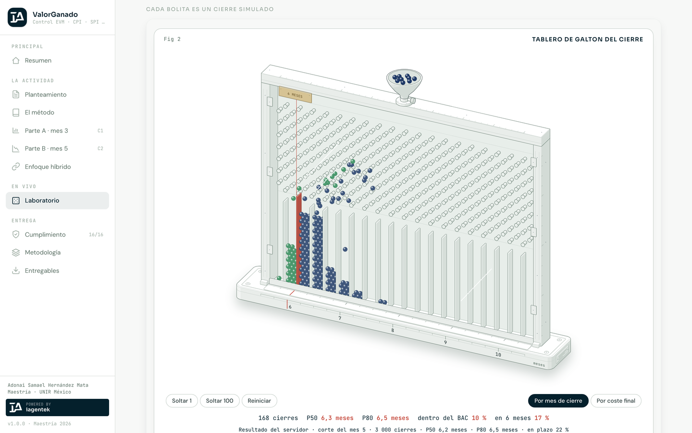<br><sub><b>Tablero de Galton</b> · cada bolita es un cierre simulado; recibe el resultado real del servidor</sub></td>
</tr>
<tr>
<td>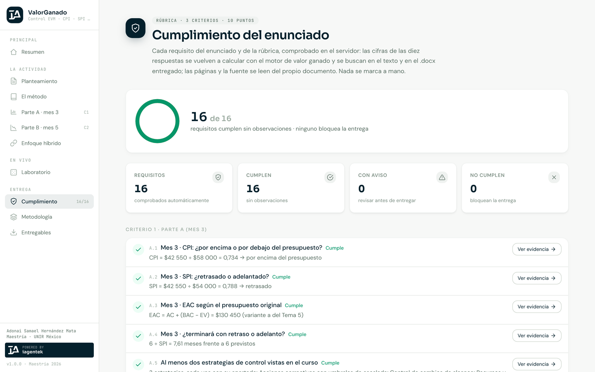<br><sub><b>Cumplimiento</b> · 16 requisitos comprobados contra los datos y el .docx, con su evidencia</sub></td>
<td>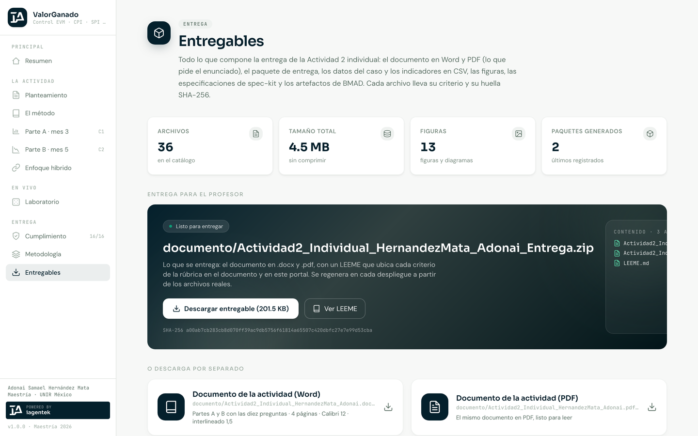<br><sub><b>Entregables</b> · paquete de entrega, documento en Word y PDF, y catálogo de 36 archivos con SHA-256</sub></td>
</tr>
</table>

<details>
<summary><b>🎬 Video completo del recorrido (MP4, 70 s)</b></summary>

[docs/readme/recorrido.mp4](docs/readme/recorrido.mp4) — resumen con la curva S, Parte A con el ciclo de control, Parte B,
enfoque híbrido con el burn-up y el cambio de corte, laboratorio con el caso «sin medidas», simulación Monte Carlo con el
tablero de Galton, cumplimiento y entregables.

</details>

## 🎮 Lo interactivo

| Qué | Dónde | Cómo funciona |
|---|---|---|
| **Curva S y medidores** | Resumen · Partes A y B | PV, AC y EV acumulados con lectura mes a mes (CV y SV al pasar el puntero); medidores de CPI y SPI con su zona de tolerancia |
| **Cálculo paso a paso** | Partes A y B | Cada indicador con su fórmula, la sustitución con las cifras del enunciado y el resultado, del EV al TCPI |
| **Burn-up y pronóstico por velocidad** | Enfoque híbrido | El mismo proyecto visto en doce iteraciones; al elegir el corte (mes 3 o 5) se dibujan los pronósticos por velocidad media y reciente frente al plazo |
| **Laboratorio de escenarios** | Laboratorio | Cambias el coste real y el avance de cada mes y el corte; el servidor recalcula CPI, SPI, EAC y duración al instante. Incluye el contrafactual **«¿y sin medidas en el mes 3?»** |
| **Simulación Monte Carlo** | Laboratorio | Un worker de Celery repite el cierre miles de veces desde el corte elegido: probabilidad de terminar dentro del BAC y en seis meses, percentiles P50 y P80 de coste y duración |
| **Tablero de Galton** | Laboratorio · Metodología | Recibe el resultado real del servidor y deja caer las bolitas por mes de cierre o por coste final |
| **Figuras isométricas** | Partes A y B · Metodología | El tablero del valor ganado, el ciclo de control del mes 3 y el tablero de Galton; se manejan con botones, teclado o arrastrando |
| **Paquete de entrega** | Entregables | Un worker genera el ZIP con el documento, su LEEME y un manifiesto SHA-256 |

> **Hallazgo de la simulación:** desde el mes 5, con una variabilidad del 20 %, la duración mediana queda en torno a
> 6,2 meses, cerca del 6,07 del documento, pero la probabilidad de cerrar dentro del BAC es baja (≈ 12 %): coincide con el
> TCPI de 1,44, que dice que sin más medidas el proyecto no vuelve al presupuesto.

> [!IMPORTANT]
> El laboratorio, la simulación y el pronóstico por velocidad son **ampliaciones del portal**: no sustituyen a las respuestas
> del documento, que siguen exactamente las fórmulas del Tema 5.

Todas las animaciones (transiciones entre páginas, gráficas que se dibujan, aparición al hacer scroll) usan la API nativa
de View Transitions y CSS, y **se desactivan si el sistema pide reducir el movimiento**.

## 📱 En el celular

<p align="center">
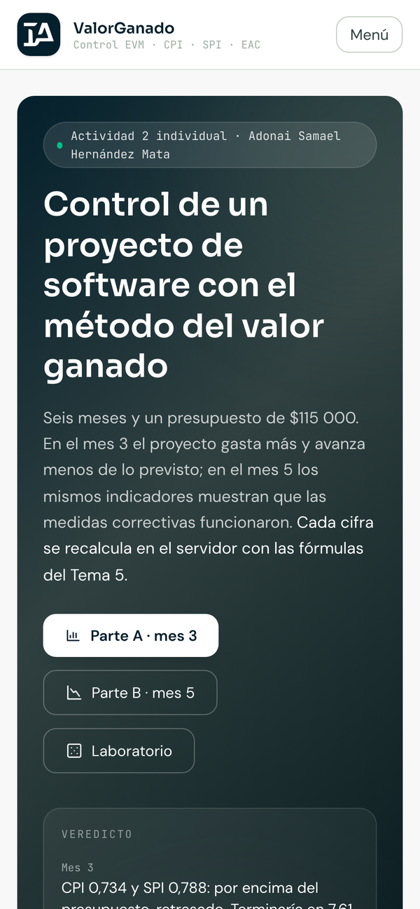&nbsp;
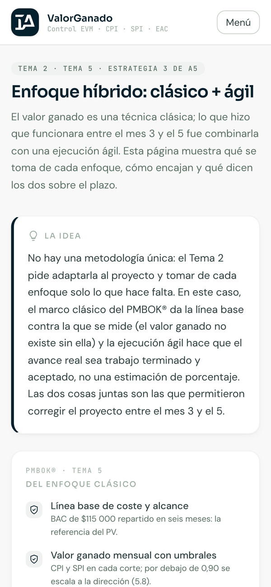&nbsp;
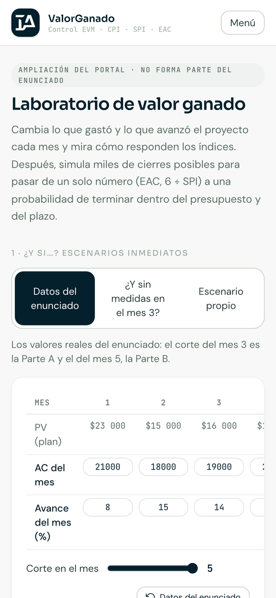
</p>

## 🧩 Figuras y diagramas

**Tres figuras isométricas interactivas** (en el portal se manejan paso a paso):

<table>
<tr>
<td width="33%">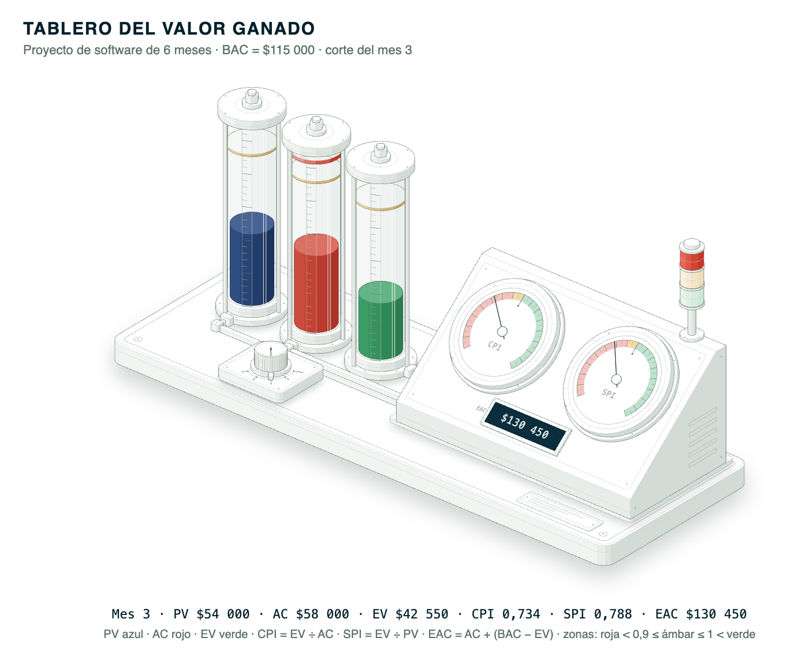<br><sub><b>Tablero del valor ganado</b> · tres caudales (PV, AC, EV) y dos agujas (CPI, SPI)</sub></td>
<td width="33%">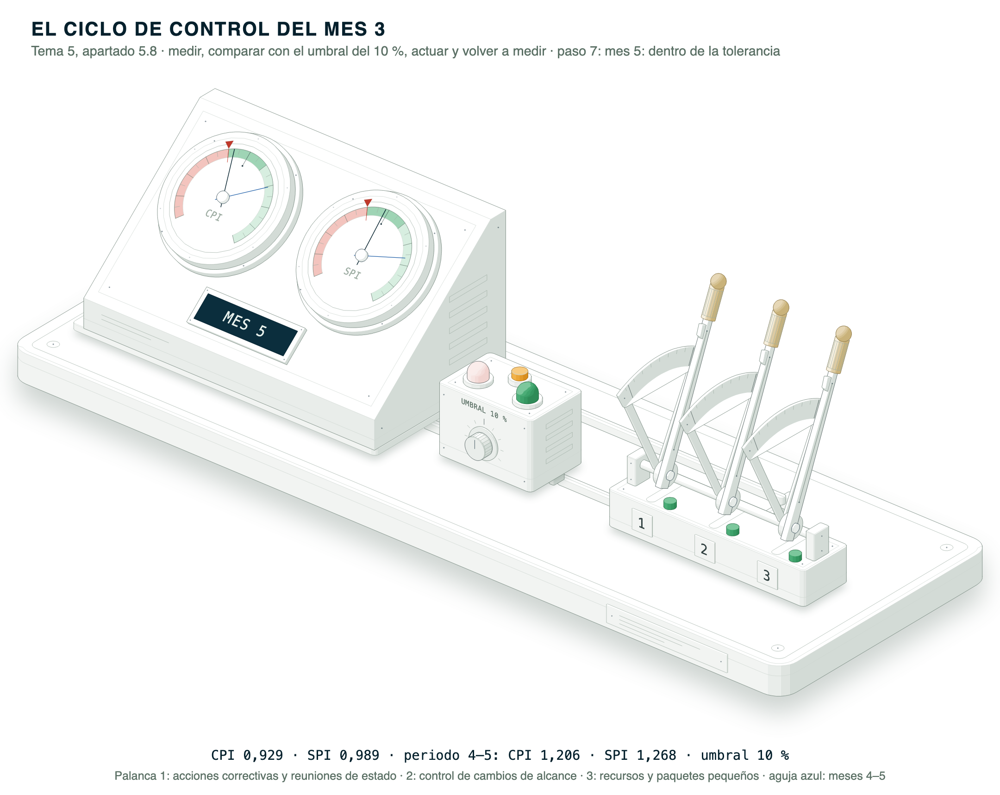<br><sub><b>Ciclo de control del mes 3</b> · umbral del 10 %, tres palancas y regreso a la tolerancia</sub></td>
<td width="33%">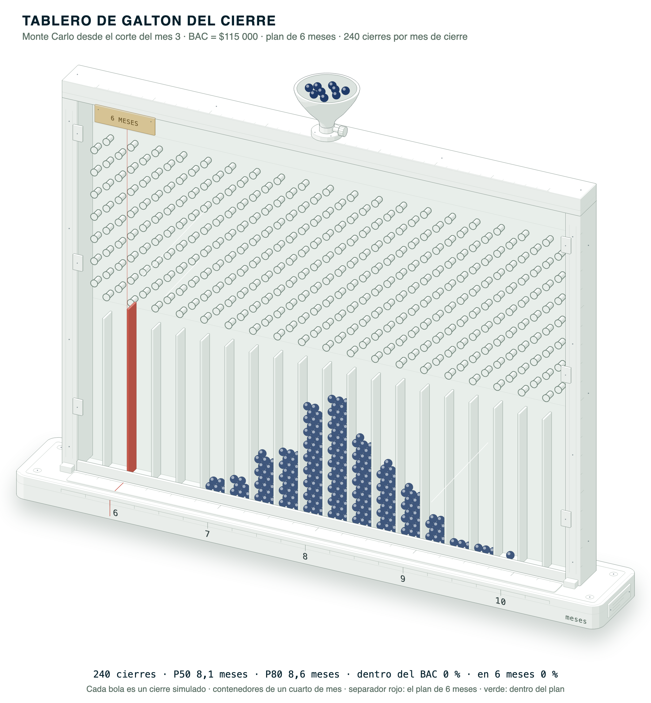<br><sub><b>Tablero de Galton del cierre</b> · cierres simulados por mes o por coste final</sub></td>
</tr>
</table>

**Nueve diagramas** (SVG, PNG y HTML en [`docs/figuras/diagramas/`](docs/figuras/diagramas/)):

<table>
<tr>
<td width="50%">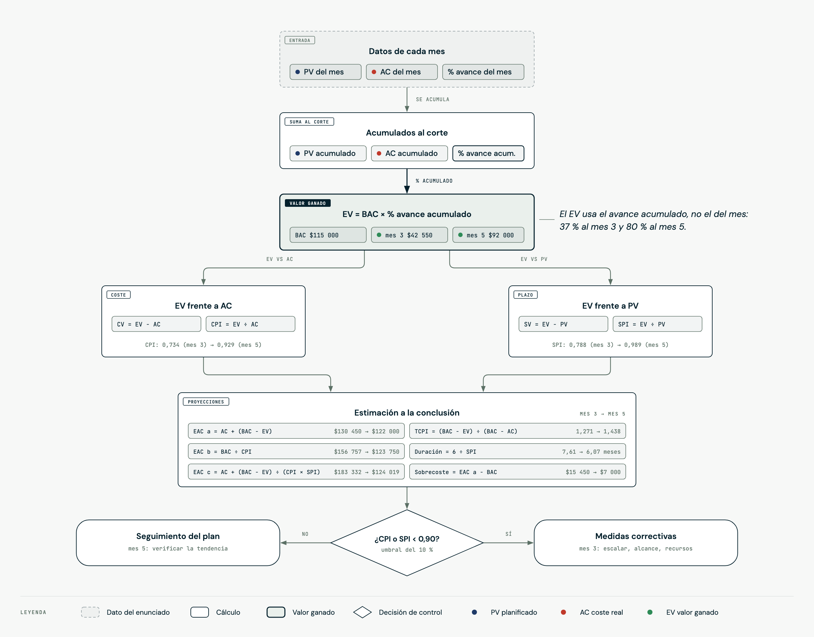<br><sub><b>Del dato a la decisión</b> · de PV, AC y avance a CPI, SPI, EAC y la decisión por umbral</sub></td>
<td width="50%">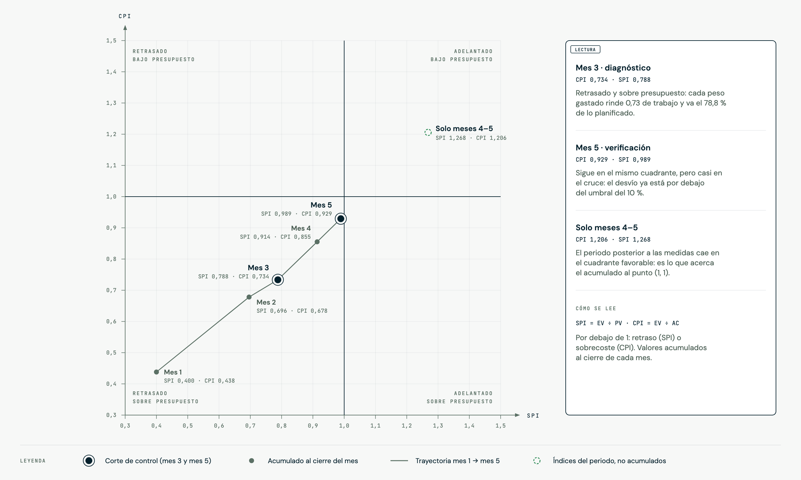<br><sub><b>Cuadrante CPI–SPI</b> · trayectoria de los meses 1 a 5 y el desempeño solo de los meses 4–5</sub></td>
</tr>
<tr>
<td>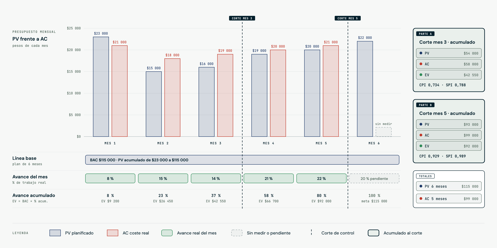<br><sub><b>Línea base frente a lo real</b> · PV, AC y avance mes a mes</sub></td>
<td>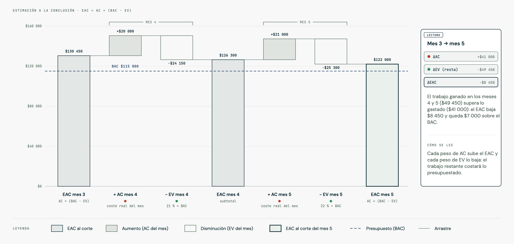<br><sub><b>Cascada del EAC</b> · del EAC del mes 3 ($130 450) al del mes 5 ($122 000)</sub></td>
</tr>
<tr>
<td>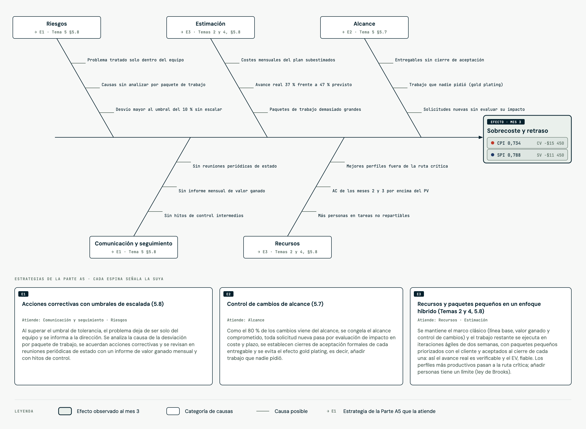<br><sub><b>Espina de causas</b> · causas posibles del desvío al mes 3 y la estrategia que ataca cada una</sub></td>
<td>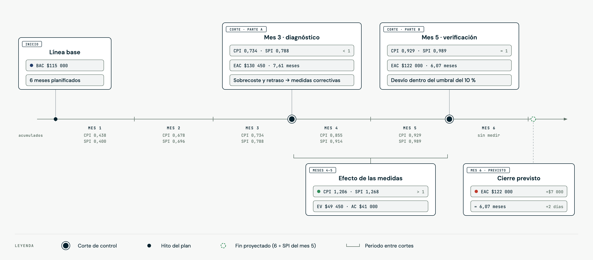<br><sub><b>Los seis meses del proyecto</b> · línea base, cortes de control y cierre previsto</sub></td>
</tr>
<tr>
<td>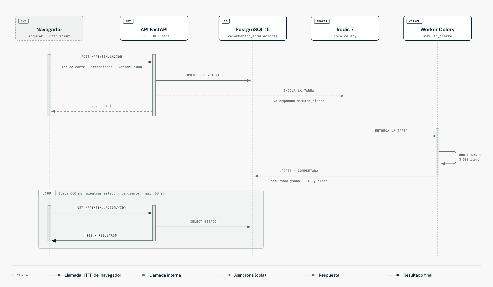<br><sub><b>Secuencia de la simulación</b> · API → base de datos → Redis → worker de Celery → consulta del resultado</sub></td>
<td><br><sub><b>Ciclo híbrido</b> · marco clásico arriba, iteraciones ágiles abajo y los cortes del mes 3 y 5</sub></td>
</tr>
</table>

## 🏗️ Arquitectura

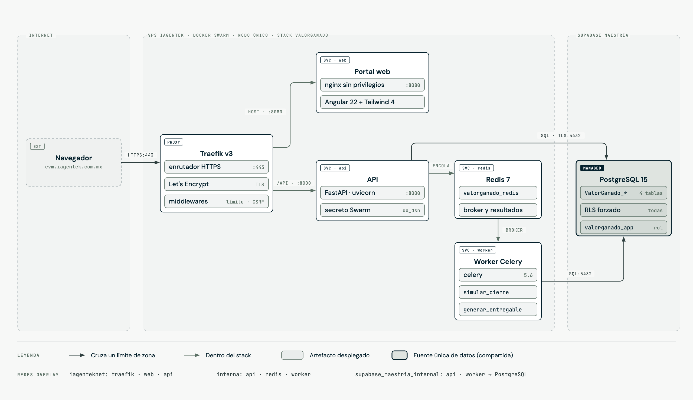

| Capa | Tecnología |
|---|---|
| **Frontend** | Angular 22 (standalone, signals, `httpResource`, View Transitions) · Tailwind CSS 4 · Forest Design System · nginx sin privilegios |
| **API** | Python · FastAPI · psycopg 3 · motor EVM propio (`backend/app/evm.py`) y cumplimiento que lee el .docx |
| **Trabajos** | Celery 5.6 con Redis 7: `simular_cierre` (Monte Carlo) y `generar_entregable` (ZIP con manifiesto SHA-256) |
| **Datos** | Supabase (PostgreSQL 15): tablas `ValorGanado_*` con seguridad por filas forzada y un rol propio de la aplicación |
| **Despliegue** | Docker Swarm, Traefik v3 con Let's Encrypt, imágenes etiquetadas con el commit |

**Seguridad:** política de contenido (CSP) estricta, HSTS, protección contra incrustación, límites de peticiones por IP,
descargas solo de archivos registrados en el catálogo, credenciales como secretos de Docker Swarm y ninguna tabla accesible
para usuarios anónimos. Los datos del servidor no viven en este repositorio.

## 🧪 Metodología

El portal se construyó con **desarrollo guiado por especificaciones** y el **método BMAD** de planeación ágil, en dos
incrementos: el portal (001) y el enfoque híbrido (002), que responde a la retroalimentación de la Actividad 1.

1. **GitHub spec-kit** — constitución → especificación → plan → contratos → tareas → lista de requisitos:
   - [`.specify/memory/constitution.md`](.specify/memory/constitution.md) — principios del proyecto.
   - [`specs/001-portal-valorganado/`](specs/001-portal-valorganado/) — spec, plan, investigación, modelo de datos, contrato de la API, tareas y requisitos.
   - [`specs/002-enfoque-hibrido/`](specs/002-enfoque-hibrido/) — spec, plan, tareas y requisitos del enfoque híbrido.
2. **Método BMAD** — product brief, PRD, arquitectura, épicas e historias y estado del sprint, en [`_bmad-output/`](_bmad-output/):

| Épica | Alcance | Estado |
|---|---|---|
| 1 | Plataforma y datos | ✅ |
| 2 | Partes A y B | ✅ |
| 3 | Resumen y cumplimiento | ✅ |
| 4 | Caso y método | ✅ |
| 5 | Laboratorio y simulación del cierre | ✅ |
| 6 | Entregables | ✅ |
| 7 | Metodología | ✅ |
| 8 | Despliegue y calidad | ✅ |
| 9 | Enfoque híbrido · clásico + ágil | ✅ |

<p align="center">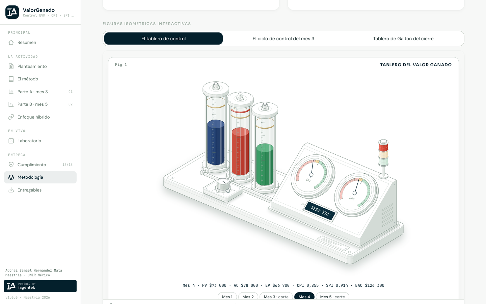</p>

## 🔍 Validación

Tres capas independientes, y todas en verde:

| Capa | Qué comprueba | Resultado |
|---|---|---|
| **Validador independiente** (`fuente/validar_entregables.py`) | Lee los datos de las tablas del enunciado oficial (no de la fuente), recalcula todo y lo busca en el .docx, el .pdf, el paquete de entrega y el portal en vivo | **38 OK · 0 avisos · 0 fallas** |
| **Cumplimiento en el servidor** (`/api/cumplimiento`) | Los 16 requisitos del enunciado y la rúbrica contra la base de datos y el .docx | **16/16** |
| **Pruebas del backend** (`backend/tests/`) | El motor EVM da exactamente las cifras de la fuente; velocidad, burn-up, simulación y cumplimiento | **24 pruebas en verde** |

## 📦 Entregables

| Archivo | Para qué |
|---|---|
| `Actividad2_Individual_HernandezMata_Adonai.docx` | El documento de la actividad (4 páginas, Calibri 12, interlineado 1,5) |
| `Actividad2_Individual_HernandezMata_Adonai.pdf` | El mismo documento en PDF, con Calibri incrustada |
| `Actividad2_Individual_HernandezMata_Adonai_Entrega.zip` | Documento + LEEME que ubica cada criterio de la rúbrica en el documento y en el portal |
| `entregables/` (36 archivos) | Datos CSV, figuras, especificaciones y planeación, cada uno con su SHA-256 en el catálogo |

Se descargan desde [/entregables](https://evm.iagentek.com.mx/entregables).

## 📁 Estructura del repositorio

```
├── backend/            API FastAPI, motor EVM, simulación, cumplimiento, Celery y 24 pruebas
├── frontend/           Portal Angular 22 + Tailwind 4 (páginas, componentes, animaciones)
├── db/                 Migraciones idempotentes: esquema, seguridad, contenido y catálogo de entregables
├── scripts/            generar_semilla.py · preparar_entregables.py · servidor_local.py
├── fuente/             calculos.py y contenido.py (copia sincronizada de la fuente del documento) + contenido.json
├── entregables/        Documento .docx/.pdf, paquete de entrega, datos CSV, figuras y especificaciones (con SHA-256)
├── docs/               Diseño, figuras isométricas, diagramas y material de este README
├── specs/              Especificaciones 001 y 002 (spec-kit)
├── _bmad-output/       Planeación (método BMAD)
└── deploy/             Stack de Docker Swarm y script de despliegue
```

## 🛠️ Reproducir

```bash
# Backend: pruebas del motor EVM
cd backend && python3 -m venv .venv && .venv/bin/pip install -r requirements.txt pytest && .venv/bin/python -m pytest -q

# Portal en local sin base de datos (consultas en memoria y Celery inmediato)
backend/.venv/bin/python scripts/servidor_local.py
cd frontend && npm ci && npx ng serve --proxy-config proxy.local.json   # http://localhost:4200

# Contenido y entregables desde fuente/
python3 scripts/generar_semilla.py && python3 scripts/preparar_entregables.py

# Despliegue: requiere deploy/.env.deploy (fuera del repositorio)
./deploy/deploy.sh
```

<div align="center">
<sub>Adonai Samael Hernández Mata · UNIR México · Metodología de Diseño y Gestión de Proyectos · 2026</sub>
</div>
