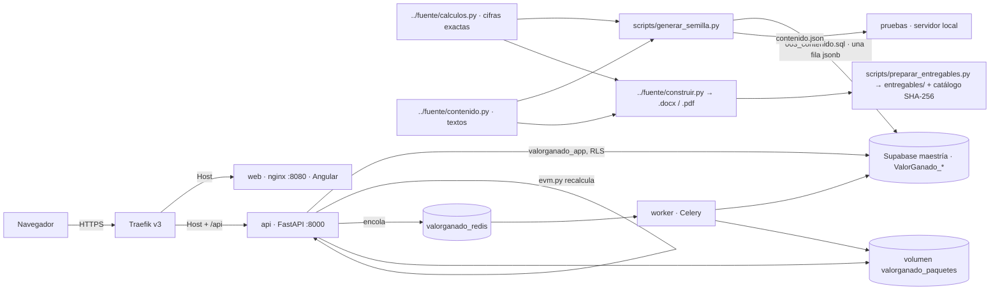
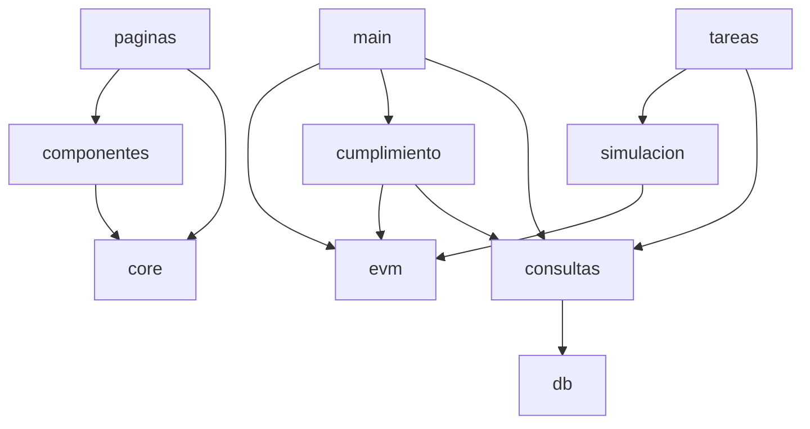
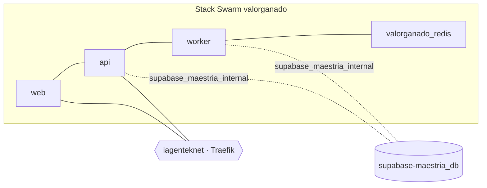

# Architecture Spine — ValorGanado · Control EVM

> La planificación detallada vive en spec-kit (`specs/001-portal-valorganado/`). Este documento fija solo
> las reglas que mantienen coherentes las piezas. Describe el **portal** (capa B); el caso del enunciado
> (capa A) son solo datos y textos.

## Design Paradigm



Capas del backend: `main.py` (HTTP, validación Pydantic) → `evm.py` (motor, función pura) /
`cumplimiento.py` / `simulacion.py` (función pura) → `consultas.py` (SQL) → `db.py`. `evm.py` y
`simulacion.py` no tocan la base.

## Invariants & Rules

### AD-1 — `fuente/` es la única fuente de cifras y textos [ADOPTED]
- **Binds:** FR-001, SC-001
- **Prevents:** que el portal y el .pdf digan cosas distintas.
- **Rule:** el contenido entra solo por `scripts/generar_semilla.py` desde `calculos.py` y `contenido.py`; el
  frontend no contiene texto académico ni cifras del caso.

### AD-2 — Datos guardados, indicadores recalculados [ADOPTED]
- **Binds:** FR-008, FR-009, FR-010, SC-002–SC-004
- **Prevents:** cifras escritas a mano que se desactualizan o difieren del documento.
- **Rule:** la base guarda BAC, duración, PV, AC y avance; `evm.py` recalcula cortes, periodo y curva S en cada
  petición; `test_evm.py` exige igualdad con `calculos.py` (rel 1e-12); `cumplimiento.py` busca cada cifra
  recalculada en la respuesta y en el .docx.

### AD-3 — Dos capas separadas; la ampliación no sustituye [ADOPTED]
- **Binds:** FR-007, FR-019
- **Prevents:** presentar la simulación o el contrafactual como la respuesta de la actividad.
- **Rule:** ids de capa A (Partes A y B, preguntas 1–5, C1–C3) solo en datos; ids de capa B (`US`, `FR`, `T`,
  épicas) solo en artefactos de planificación. El laboratorio lleva el rótulo «Ampliación del portal · no
  forma parte del enunciado» y muestra siempre el EAC (a) y `6 ÷ SPI` junto a los percentiles.

### AD-4 — Un motor para todo [ADOPTED]
- **Binds:** FR-003, FR-012, FR-016
- **Prevents:** que el laboratorio, la simulación y las Partes A y B calculen distinto.
- **Rule:** `/contenido`, `/resumen`, `/cumplimiento`, `/escenario` y la tarea de simulación usan las mismas
  funciones `evm.corte()`, `evm.periodo()` y `Datos.validar()`.

### AD-5 — Aislamiento de datos [ADOPTED]
- **Binds:** FR-021, SC-007
- **Rule:** tablas `public."ValorGanado_<tabla>"`; RLS habilitado y forzado; `anon`/`authenticated` sin
  privilegios; única política para `valorganado_app`; la API solo lee contenido y catálogo y solo escribe en
  `simulaciones` y `paquetes`. DSN en el secreto `valorganado_db_dsn_v1`.

### AD-6 — Trabajo pesado fuera de la API [ADOPTED]
- **Binds:** FR-015, FR-018, SC-005
- **Rule:** simulación y ZIP solo como tareas Celery (`valorganado.simular_cierre`,
  `valorganado.generar_entregable`). La API inserta la fila, encola con el mismo id y responde 202; la fila en
  Postgres es la fuente del estado. El escenario del laboratorio es cálculo inmediato, sin cola.

### AD-7 — Seguridad en el borde [ADOPTED]
- **Binds:** FR-021
- **Rule:** HSTS, cabeceras de la API, límite de tasa (20/s ráfaga 60; `POST` 60/min ráfaga 10) y de cuerpo
  (8192 bytes) como middlewares de Traefik; CSP y demás cabeceras del SPA en nginx; la API valida rangos y la
  cabecera `X-Requested-With: portal-valorganado`. Descargas solo de rutas del catálogo. Contenedores sin root.

### AD-8 — Despliegue por sha [ADOPTED]
- **Binds:** SC-008
- **Rule:** imágenes `:<sha corto>` (sufijo `-dirty` si hay cambios sin commit); solo `deploy/deploy.sh`
  despliega y verifica; el stack nunca usa `:latest`.

### AD-9 — Redis con nombre de servicio completo [ADOPTED]
- **Binds:** FR-015, FR-018, FR-024
- **Prevents:** que la API o el worker hablen con el Redis de otro stack.
- **Rule:** se direcciona como `valorganado_redis`; en `iagenteknet` el nombre corto `redis` resuelve al
  servicio de otro stack.

### AD-10 — Movimiento nativo y figuras del mismo origen [ADOPTED]
- **Binds:** FR-019, FR-023, SC-009
- **Rule:** View Transitions (`withViewTransitions()`) y CSS propio, sin biblioteca de animación; todo se anula con
  `prefers-reduced-motion: reduce` (`sinMovimiento()`). Las figuras isométricas interactivas se incrustan con
  `componentes/figura.ts` solo bajo `/figuras/` del mismo origen; nginx permite `frame-ancestors 'self'`
  únicamente ahí.



## Consistency Conventions

| Concern | Convention |
| --- | --- |
| Naming | Español, `snake_case` en Python y SQL, un archivo `.ts` por página o componente; tablas `ValorGanado_<plural>` |
| Meses | entero `1…6`; los cortes de la actividad son 3 (Parte A) y 5 (Parte B); el periodo de las medidas, 4–5 |
| Importes e índices | `float` en JSON; el frontend formatea con `core/formato.ts` igual que el documento ($130 450, 0,734, 7,61) |
| Indefinidos | división entre cero → `null` en JSON → «—» en la UI |
| Errores | `{"detail": "<mensaje en español>"}` + código HTTP; la UI lo muestra o lo traduce (429, 503) |
| Estados de trabajos | `pendiente` → `completada` \| `error` |
| Ampliaciones | rótulo «ampliación del portal» en la UI |
| Frontend | standalone, signals, `httpResource`; `estado.ts` para carga/vacío/error; curvas con los colores de la figura 1 |
| Configuración | DSN en `/run/secrets/valorganado_db_dsn` (`DATABASE_URL_FILE`); en local `DATABASE_URL`, `REDIS_URL`, `REDIS_RESULT_URL`, `ENTREGABLES_DIR`, `PAQUETES_DIR`, `CORS_ORIGINS` |

## Stack

| Name | Version |
| --- | --- |
| Python | 3.11 |
| FastAPI + Uvicorn | 0.141 + 0.54 |
| psycopg | 3.x (con `psycopg_pool`) |
| pypdf | ≥ 5 |
| Celery | 5.6 |
| Redis | 7 |
| PostgreSQL (Supabase maestría) | 15 |
| Angular | 22.2 |
| Tailwind CSS | 4.3 |
| Traefik | v3 |
| Docker Swarm | nodo único iaGentek |

## Structural Seed

```text
dev/                       # repo github.com/azulls1/evm, dentro de «Actividad 2 individual/»
  fuente/             # copia de ../fuente (calculos.py, contenido.py) + contenido.json generado
  backend/app/        # main, config, db, consultas, evm, cumplimiento, simulacion, celery_app, tareas
  backend/tests/      # conftest, test_evm (12), test_simulacion (4), test_cumplimiento (2)
  frontend/src/app/   # paginas/ (8 componentes, 9 rutas), componentes/ (12), core/ (modelos, formato, movimiento)
  db/migraciones/     # 001_esquema.sql, 002_seguridad.sql, 003_contenido.sql (generada)
  scripts/            # generar_semilla.py, preparar_entregables.py, servidor_local.py
  deploy/             # stack.yml, deploy.sh, .env.deploy.ejemplo
  docs/               # DISENO.md, figuras/ (figuras isométricas interactivas y diagramas propios)
  specs/              # spec-kit (capa B)
  _bmad-output/       # BMAD (capa B)
```



## Capability → Architecture Map

| Capability / Area | Lives in | Governed by |
| --- | --- | --- |
| Partes A y B (FR-003, FR-004) | `evm.py`, `/contenido`, `paginas/parte.ts`, `curva-s.ts`, `medidor.ts` | AD-1, AD-2, AD-4 |
| Caso y método (FR-002, FR-005, FR-006) | `/contenido`, `paginas/planteamiento.ts`, `paginas/metodo.ts` | AD-1 |
| Cumplimiento y resumen (FR-010, FR-011) | `cumplimiento.py` (pypdf), `/resumen`, `/cumplimiento`, `paginas/resumen.ts`, `paginas/cumplimiento.ts` | AD-2 |
| Laboratorio (FR-012, FR-013) | `Escenario` en `main.py`, `/escenario`, `paginas/laboratorio.ts` | AD-3, AD-4 |
| Simulación (FR-014–FR-016) | `simulacion.py`, `tareas.py`, `/simulacion`, `histograma.ts` | AD-3, AD-6, AD-9 |
| Entregables (FR-017, FR-018) | `scripts/preparar_entregables.py`, `/entregables`, `tareas.py`, volumen | AD-6, AD-7 |
| Metodología (FR-019) | `paginas/metodologia.ts`, `figura.ts`, `diagrama.ts`, `docs/figuras/` | AD-10 |
| Seguridad (FR-021, SC-007) | `002_seguridad.sql`, `main.py`, labels Traefik, `frontend/seguridad-headers*.conf` | AD-5, AD-7 |
| Despliegue (SC-008) | `deploy/` | AD-8, AD-9 |
| Desarrollo local | `scripts/servidor_local.py`, `frontend/proxy.local.json` | AD-4 |

## Deferred

- Autenticación y edición en línea: no hay escrituras de contenido; se reabre solo si el portal se vuelve
  multi-actividad.
- Guardar escenarios del laboratorio: no aporta a la evaluación y obligaría a moderar datos de visitantes.
- Caché de lecturas: una fila y < 100 ms; no hace falta.
- Observabilidad más allá de `/health` y logs de Swarm: uso de demostración.
