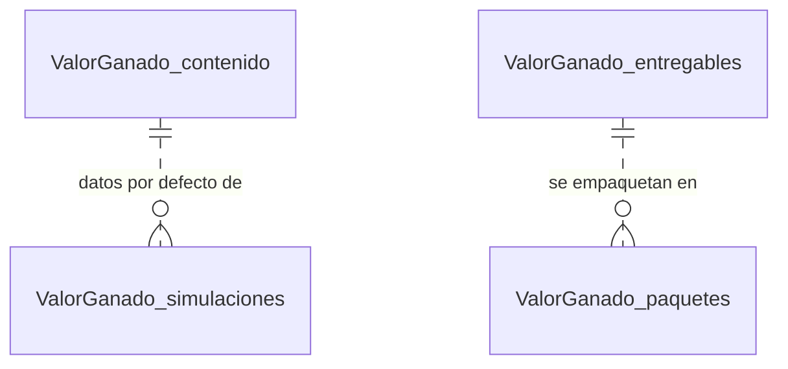

# Data Model — Fase 1

PostgreSQL 15 de Supabase maestría, esquema `public`. Cuatro tablas con prefijo `ValorGanado_` (los
nombres se citan entre comillas dobles por la mayúscula). Migraciones: `db/migraciones/001_esquema.sql`,
`002_seguridad.sql` y `003_contenido.sql` (generada), más `db/catalogo_entregables.sql` (generado). Todas
son idempotentes.

**Quién escribe**: `ValorGanado_contenido` la llena `003_contenido.sql` (de `scripts/generar_semilla.py`) y
`ValorGanado_entregables`, `db/catalogo_entregables.sql` (de `scripts/preparar_entregables.py`); `deploy.sh`
aplica ambos con el administrador de la base. La API solo las lee. `ValorGanado_simulaciones` y
`ValorGanado_paquetes` las escribe la API (insertar) y el worker (actualizar).

**Lo que no se guarda**: EV, CV, SV, CPI, SPI, EAC, TCPI, VAC, duración estimada, curva S, desempeño de
los meses 4–5 y cumplimiento se calculan en la API en cada petición (principio II). No se guardan IP ni
datos de visitantes.



(Relaciones lógicas, sin claves foráneas: la simulación copia el escenario en `parametros` y el paquete
copia los archivos en el ZIP.)

## 1. `ValorGanado_contenido` — una sola fila

| Columna | Tipo | Restricciones / origen |
|---|---|---|
| `id` | text | PK, `check (id = 'actividad2')` |
| `datos` | jsonb | not null · todo el contenido (ver estructura) |
| `actualizado_en` | timestamptz | not null, `default now()`; se renueva en cada carga |

Estructura de `datos` (la arma `generar_semilla.construir()`):

| Clave | Contenido | Origen |
|---|---|---|
| `portada` | universidad, programa, asignatura, actividad, alumno, profesora, fecha | `contenido.PORTADA` |
| `introduccion` | párrafo de introducción | `contenido.INTRODUCCION` |
| `nota_avance` | por qué el EV usa el avance acumulado (37 % y 80 %) | `contenido.NOTA_AVANCE` |
| `formulas[]` | `{indicador, formula}` × 5 (EV, CV/CPI, SV/SPI, EAC a, duración) | `contenido.FORMULAS` |
| `datos` | `{bac: 115000, duracion: 6, pv_mes: [23000, 15000, 16000, 19000, 20000, 22000], ac_mes: [21000, 18000, 19000, 20000, 21000], avance_mes: [8, 15, 14, 21, 22]}` | `calculos.py` |
| `partes.A` | `{mes: 3, titulo, preguntas[5], estrategias[3]}` | `contenido.PARTE_A`, `ESTRATEGIAS_A_INTRO`, `ESTRATEGIAS_A` |
| `partes.B` | `{mes: 5, titulo, preguntas[5]}` | `contenido.PARTE_B` |
| `preguntas[]` | `{n, pregunta (título corto), enunciado (texto literal), respuesta}` | `contenido.py` + `ENUNCIADO` de `generar_semilla.py` |
| `periodo` | `{desde: 4, hasta: 5}` (meses en que actúan las medidas) | `generar_semilla.py` |
| `conclusion` | párrafo de conclusión | `contenido.CONCLUSION` |
| `referencias[]` | PMBOK® 7.ª ed. y Temas 4 y 5 de UNIR | `contenido.REFERENCIAS` |
| `enunciado` | `{comunes[4], A5, B5, extension, rubrica[3]}` (C1 4 pts 40 %, C2 4 pts 40 %, C3 2 pts 20 %) | `ENUNCIADO` de `generar_semilla.py` |

Las respuestas ya llevan las cifras formateadas como en el documento porque `contenido.py` las interpola
desde `calculos.py` (p. ej. «CPI = $42 550 ÷ $58 000 = 0,734»). Las mismas claves se escriben en
`fuente/contenido.json`, que usan las pruebas y el servidor local.

## 2. `ValorGanado_simulaciones`

| Columna | Tipo | Restricciones |
|---|---|---|
| `id` | uuid | PK, `default gen_random_uuid()` (también es el id de la tarea de Celery) |
| `task_id` | text | null · id de Celery |
| `estado` | text | not null, `default 'pendiente'`, `check (estado in ('pendiente','completada','error'))` |
| `parametros` | jsonb | not null · `{mes, iteraciones, variabilidad, ventana, semilla, escenario}`; `escenario` siempre lleno (si el visitante no envía uno, se copian los datos del enunciado) |
| `resultado` | jsonb | null · salida de `simulacion.simular()`, ver `contracts/api.md` |
| `error` | text | null · mensaje genérico en español (el detalle va al log del worker) |
| `duracion_ms` | int | null |
| `creado_en` | timestamptz | not null, `default now()` |
| `completado_en` | timestamptz | null |

Índice `"ValorGanado_simulaciones_creado"` sobre `(creado_en desc)` para `/simulacion/ultima`. El worker
conserva las 200 más recientes (`consultas.purgar_simulaciones`).

## 3. `ValorGanado_entregables`

| Columna | Tipo | Restricciones |
|---|---|---|
| `ruta` | text | PK · relativa a `/app/entregables` en la imagen del backend |
| `nombre` | text | not null |
| `tipo` | text | not null · Documento, PDF, Paquete, Datos, Figura, Especificación, BMAD |
| `criterio` | text | not null · Entrega, Datos, C1 · C2, C2, Figuras, spec-kit, BMAD |
| `detalle` | text | not null, `default ''` |
| `bytes` | bigint | not null |
| `sha256` | text | not null, `check (length(sha256) = 64)` |
| `orden` | smallint | not null, `default 0` |

`preparar_entregables.py` recalcula `bytes` y `sha256` en cada despliegue (dato medido, no escrito) y el
catálogo se reemplaza completo (`delete` + `insert` en una transacción). Contenido típico: el .docx y el
.pdf, el paquete de entrega (con LEEME), `datos/linea_base_y_mediciones.csv`, `datos/indicadores_por_corte.csv`,
`figuras/curva-s.png`, las figuras y diagramas de `docs/figuras/`, los `.md` de `specs/`, la constitución y
los artefactos de `_bmad-output/`.

## 4. `ValorGanado_paquetes`

| Columna | Tipo | Restricciones |
|---|---|---|
| `id` | uuid | PK, `default gen_random_uuid()` |
| `task_id` | text | null |
| `estado` | text | not null, `default 'pendiente'`, `check (estado in ('pendiente','completada','error'))` |
| `archivo` | text | null · `ValorGanado_Actividad2_HernandezMata_<fecha>_<id8>.zip` en el volumen `valorganado_paquetes` |
| `n_archivos` | int | null · archivos del catálogo + `MANIFIESTO_SHA256.txt` |
| `bytes` | bigint | null |
| `sha256` | text | null |
| `error` | text | null |
| `creado_en` | timestamptz | not null, `default now()` |
| `completado_en` | timestamptz | null |

El worker conserva los 3 paquetes más recientes y borra del volumen cualquier ZIP que ya no esté
registrado. Un paquete `pendiente` de menos de 2 minutos, o el último completado posterior al catálogo
desplegado, se reutiliza en lugar de generar otro.

## Estructuras calculadas (no se guardan)

`backend/app/evm.py`:

- **`Datos`** (`bac`, `duracion`, `pv_mes`, `ac_mes`, `avance_mes`) con `validar()`: la línea base tiene un valor
  por mes planificado y suma el BAC (±0,5); AC y avance tienen el mismo número de meses medidos (1 a
  `duracion`); avance acumulado ≤ 100 % y sin valores negativos.
- **Corte** (`corte(d, mes)`): `mes, pv, ac, avance, ev, cv, sv, cpi, spi, eac_a, eac_b, eac_c, tcpi, duracion, vac`
  y las lecturas `coste` («por encima del presupuesto» | «según lo planificado» | «por debajo del
  presupuesto») y `plazo` («retrasado» | «según lo planificado» | «adelantado»). Divisiones entre cero → `null`.
- **Periodo** (`periodo(d, desde, hasta)`): `desde, hasta, ev, ac, pv, cpi, spi` de un tramo.
- **Serie** (`serie(d)`): curva S mes a mes; PV en todo el plan, AC y EV hasta el último mes medido (`null` después).

| Corte | PV | AC | Avance | EV | CV | SV | CPI | SPI | EAC a | EAC b | TCPI | Duración |
|---|---|---|---|---|---|---|---|---|---|---|---|---|
| Mes 3 | $54 000 | $58 000 | 37 % | $42 550 | −$15 450 | −$11 450 | 0,734 | 0,788 | $130 450 | $156 757 | 1,271 | 7,61 |
| Mes 5 | $93 000 | $99 000 | 80 % | $92 000 | −$7 000 | −$1 000 | 0,929 | 0,989 | $122 000 | $123 750 | 1,438 | 6,07 |
| Meses 4–5 | $39 000 | $41 000 | 43 % | $49 450 | | | 1,206 | 1,268 | | | | |

`backend/app/cumplimiento.py`: **Requisito** `{id, criterio, texto, cumplido, aviso, evidencia, ruta}`.

## Seguridad (`002_seguridad.sql`)

```sql
-- rol propio (contraseña con -v app_password=…)
create role valorganado_app login;            -- si no existe
alter role valorganado_app set search_path = public;
grant usage on schema public to valorganado_app;
-- para cada tabla t con prefijo ValorGanado_ (y cada secuencia):
revoke all on public."ValorGanado_t" from anon, authenticated;
alter table public."ValorGanado_t" enable row level security;
alter table public."ValorGanado_t" force row level security;
grant select, insert, update, delete on public."ValorGanado_t" to valorganado_app;
create policy "ValorGanado_app_todo" on public."ValorGanado_t"
  for all to valorganado_app using (true) with check (true);
```

`valorganado_app` es `LOGIN`, sin `BYPASSRLS`. El archivo se reaplica al final de cada despliegue porque los
privilegios por defecto del esquema `public` de Supabase abren las tablas nuevas a `anon`/`authenticated`.

## Reglas de validación

- `calculos.py` afirma al importarse que el PV acumulado suma el BAC y que el avance acumulado es 37 % al
  mes 3 y 80 % al mes 5 (`assert`).
- La API valida cada escenario con Pydantic (rangos) y con `Datos.validar()` (coherencia); la simulación
  rechaza un mes de corte sin mediciones.
- Las restricciones `check` de la base rechazan estados y huellas inválidos; `003_contenido.sql` y el
  catálogo van en una transacción, así que si algo falla la carga se revierte completa.
